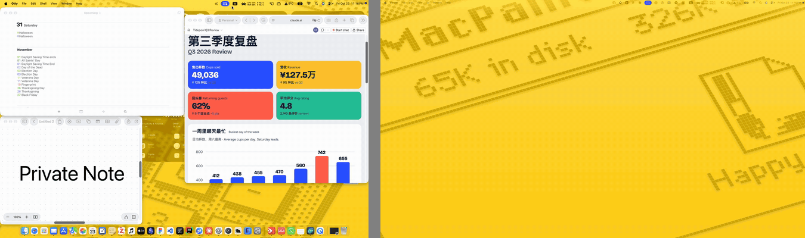
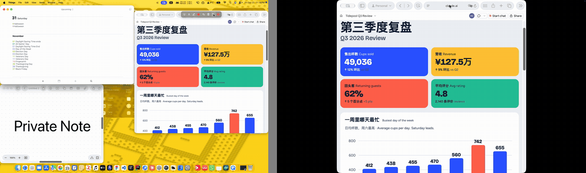

<p align="center"></p>

<h1 align="center">WindowMirror</h1>

<p align="center"><b>Put one window on the projector. Keep the rest of your screen to yourself.</b></p>

<p align="center">
  <a href="https://github.com/haoyibits/WindowMirror/releases/latest"></a>
  
  
  <a href="LICENSE"></a>
</p>

<p align="center">English · <a href="README_zh.md"><b>简体中文</b></a></p>

<p align="center"></p>
<p align="center"><sub>Left: your Mac. Right: the projector. The note on the left never shows up on the right.</sub></p>

---

WindowMirror is a free menu bar app for macOS. It mirrors a single window to a projector or second monitor in real time, and lets you draw on it while you present. Your chats, notifications and desktop stay on your own screen.

## Why not just mirror or extend the display?

| | What the audience sees | What you see |
|---|---|---|
| **Mirror Displays** (built into macOS) | Your entire screen, including chat pop-ups and other apps | The same thing |
| **Extended display** | The window you dragged over | Nothing. You have to turn around to look at it |
| **Screen sharing in a video call** | One window, but only for people on the call | Your normal screen |
| **WindowMirror** | One window, full screen on the projector | Your normal screen, with that window still where you can work in it |

It works with any app: a browser, a code editor, Figma, a PDF, a terminal.

## Get started

1. **[Download the DMG](https://github.com/haoyibits/WindowMirror/releases/latest)** and drag WindowMirror into Applications.
2. Click the menu bar icon (two overlapping rectangles), then **Pick Window…**, and click the window you want to show.
3. That window fills the second screen. Click **Stop Mirroring** when you're done.

The first time you open it, macOS will block it. See [First launch](#first-launch) below. It takes about 20 seconds.

## Draw on it while you present

<p align="center"></p>

You draw on the window on your own screen, and the projector shows the same marks. Use the toolbar above the window, or the shortcuts:

- **Laser pointer** (⌃⌥L): a glowing dot that follows your mouse. You can keep clicking and scrolling the window.
- **Pen** (⌃⌥D) and **highlighter** (⌃⌥H): circle a number, underline a line of code.
- **Undo** (⌃⌥Z), **clear** (⌃⌥C), and an option to fade strokes out after a few seconds.

## Fill the projector, no black bars

<p align="center"></p>

A window rarely has the same shape as the projector, so you get black bars. One click resizes the window to the projector's aspect ratio, or to its exact pixel size for the sharpest picture.

## Also

- **Smooth and sharp:** 60 fps at the window's native resolution. HDR and wide color are kept when your displays support them.
- **Doesn't get in your way:** the mirror never takes focus from your main screen, and it keeps updating when the window is covered by other windows.
- **Stays out of the Dock:** everything lives in the menu bar.
- **English and Chinese:** follows your system language. You can also switch it from the menu.

## First launch

WindowMirror isn't notarized by Apple, so the first time you open it macOS says it can't verify the app. To open it anyway:

1. Open it once and close the warning.
2. Go to **System Settings › Privacy & Security**, scroll down, and click **Open Anyway** next to WindowMirror.

Or run this in Terminal:

```bash
xattr -dr com.apple.quarantine /Applications/WindowMirror.app
```

Then it asks for two permissions, both under System Settings › Privacy & Security:

| Permission | Why it needs it | If you say no |
|---|---|---|
| Screen & System Audio Recording | To see the window's contents | You can still use **Pick Window…** |
| Accessibility | To resize the window to fit the projector | Everything else works |

## FAQ

**Is it free?** Yes. It's open source under the MIT license.

**Does it upload my screen anywhere?** No. The app makes no network connections. Everything stays on your Mac.

**I only have one screen. Can I use it?** Yes. The mirror opens as a regular window on your screen instead.

**Which Macs does it run on?** macOS 14 Sonoma or later, on Apple silicon and Intel.

**Something's not working.** Please [open an issue](https://github.com/haoyibits/WindowMirror/issues). If WindowMirror is useful to you, a ⭐ helps other people find it.

## Reference

<details>
<summary><b>All shortcuts</b></summary>

| Shortcut | Action |
|---|---|
| ⌘P | Pick Window… (while the menu is open) |
| ⌃⌥L | Laser pointer. Clicks pass through to the window, and the system cursor is hidden in the mirror |
| ⌃⌥D | Pen |
| ⌃⌥H | Highlighter |
| ⌃⌥Z | Undo last stroke |
| ⌃⌥C | Clear all |
| ⌃⌥X | Exit annotation mode and clear all strokes |
| ⌃⌥M | Resize the window to the projector's pixel size (1:1) |
| ⌃⌥R | Resize the window to the projector's aspect ratio, as large as fits |

The annotation shortcuts work from any app. Pressing the current tool's shortcut again exits annotation mode. With the pen or highlighter on, the drawing layer takes the mouse, so switch to the laser pointer or exit to click the window again.

</details>

<details>
<summary><b>Menu options</b></summary>

**Choosing a window and display.** Pick a window by clicking it, or from "Choose from Main-Screen Windows". The first secondary display is used by default; choose another under "Target Display". To stop, click "Stop Mirroring", or click the mirror and press Esc. Mirroring also stops when the window closes. While mirroring, the menu shows the source and target pixel sizes and the scale factor.

**Fit Source Window to Target.**

| Option | Result |
|---|---|
| Pixel 1:1 | The window matches the projector's pixel size. Sharpest |
| Same Ratio, Largest | The largest size at the projector's aspect ratio that fits your screen |
| Same Ratio, Keep Width | Changes only the height |
| Same Ratio, Keep Height | Changes only the width |

If the window doesn't fit, it's scaled down and moved back on screen. Some apps limit window sizes (terminals resize in whole rows and columns), so the ratio can be slightly off. The app tells you by how much.

**Scaling.** Fit, fill, stretch, or native pixels (1:1, centered).

**Annotate.** Choose the stroke color, turn on fading strokes, and show or hide the toolbar above the window. The toolbar follows the window and is never captured in the mirror.

**Language / 语言.** Follow System, English or 简体中文. The change applies the next time you open the menu.

</details>

<details>
<summary><b>Known limitations</b></summary>

- The mirror stops updating while the window is minimized.
- Two different displays won't match colors exactly, especially with True Tone on.
- If the second screen uses a scaled resolution, macOS scales the image again, so physical pixels aren't strictly 1:1.

</details>

<details>
<summary><b>Build from source</b></summary>

You need the Xcode Command Line Tools for `swiftc`.

```bash
git clone https://github.com/haoyibits/WindowMirror.git
cd WindowMirror
./install.sh
```

`install.sh` builds and signs the app, installs it to `/Applications`, and launches it. `./build.sh` builds without installing, into `~/Library/Caches/WindowMirror/`. `./package.sh` builds a universal app and packs it into a DMG in the same folder. Build output stays out of the project folder because macOS adds extended attributes to `.app` bundles in iCloud-synced folders, which breaks code signing.

The app is ad-hoc signed, so macOS treats every rebuild as a new app. After rebuilding, remove the old entries under both permissions and add the app again. To avoid this, replace `--sign -` in `build.sh` with the name of a stable code-signing certificate.

```
Sources/main.swift        Menu bar app, capture engine, mirror window, window resizing, localization
Sources/Annotation.swift  Annotations: model, rendering, overlay layer, global shortcuts
Sources/Toolbar.swift     Floating toolbar above the source window
Icon/draw_icon.swift      Draws the app icon with Core Graphics
Resources/*.lproj         Localized app name
docs/media/               Demo GIFs for this README
```

</details>

## License

[MIT](LICENSE)
