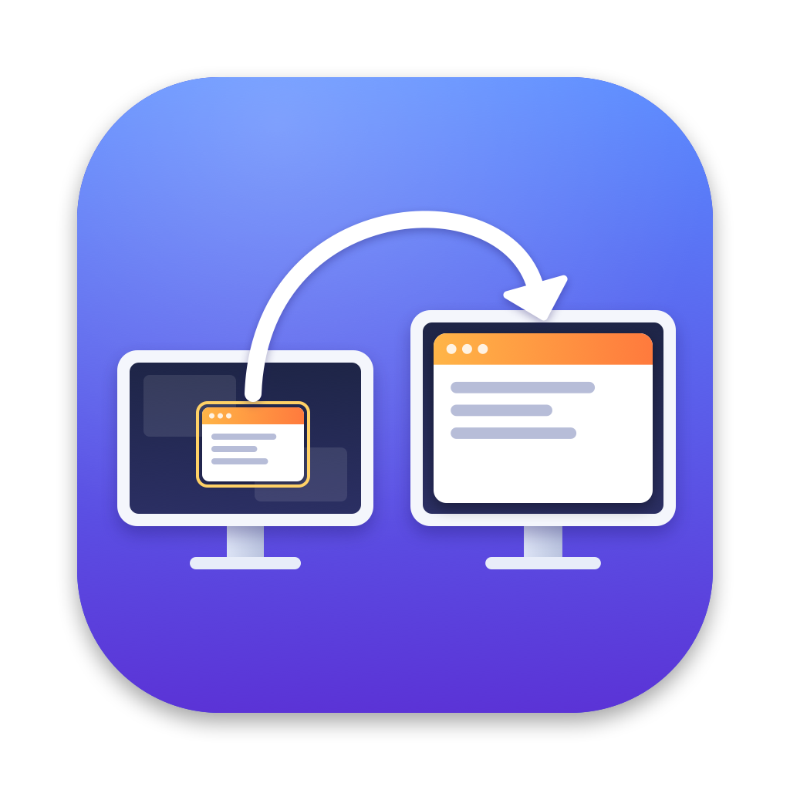

<p align="center"></p>

<h1 align="center">WindowMirror · 窗口镜像</h1>

<p align="center">把主屏上的某一个窗口实时镜像到副屏（投影仪、第二块显示器），并在上面用激光笔、画笔做标注。</p>

<p align="center"><a href="README.md">English</a> · 简体中文</p>

---

适合演示、上课、开会时把一个窗口投到外接屏幕。观众只看到你选中的窗口，主屏上的其他内容不会露出去。

## 功能

- **单窗口镜像：** 基于 ScreenCaptureKit，60 帧，按源窗口的原生分辨率抓取。窗口被遮挡或者部分移出屏幕时，画面照常更新。
- **副屏全屏显示：** 镜像在副屏上无边框铺满并置顶，不会抢走主屏焦点。只有一块屏时，退回为主屏上的普通窗口。
- **按副屏调整源窗口：** 一键把源窗口调成副屏的像素尺寸（1:1），或者只匹配宽高比，让副屏铺满、没有黑边。
- **HDR 与广色域：** 用半精度浮点和扩展 Display P3 抓取，保留高光，副屏用 EDR 显示。不支持时自动退回标准动态范围。
- **标注：** 激光笔、画笔、荧光笔。在主屏源窗口上画，副屏同步显示。支持全局快捷键、多种颜色、撤销，以及笔迹自动消失。
- **缩放方式：** 适应、填充、拉伸、原始像素（1:1 居中）四种。
- **常驻菜单栏：** 没有 Dock 图标，所有操作都在菜单栏图标里。
- **中英双语：** 界面跟随系统语言，也可以在菜单里切换。

## 安装

需要 macOS 14 及以上，以及 Xcode 命令行工具（提供 `swiftc`）。

```bash
git clone https://github.com/haoyibits/WindowMirror.git
cd WindowMirror
./install.sh
```

`install.sh` 会编译、签名、安装到 `/Applications`，然后启动 App。如果只想编译不安装，运行 `./build.sh`，产物在 `~/Library/Caches/WindowMirror/`。

### 权限

| 权限 | 用途 | 不授权时 |
|---|---|---|
| 屏幕与系统录音 | 列出窗口、抓取画面 | 只能用“点选窗口…”（系统选择器，无需此权限） |
| 辅助功能 | 按副屏调整源窗口的大小 | 调整功能不可用，其余正常 |

两项都在“系统设置 › 隐私与安全性”里设置。

> **注意：** App 使用 ad-hoc 签名，每次重新构建签名都会变化，系统会把它当成新 App。重新构建后需要在上面两处删掉旧条目、重新添加。如果想避免这个问题，可以改用固定的代码签名证书，在 `build.sh` 里把 `--sign -` 换成证书名称。

## 使用

点菜单栏的双矩形图标：

1. **选择窗口：** 用“点选窗口…”（⌘P）直接点选，或者从“从主屏窗口列表选择”里挑。
2. **目标显示器：** 默认是第一块副屏，也可以在菜单里指定。
3. **停止：** 菜单里点“停止镜像”，或者点一下副屏画面后按 Esc。源窗口关闭时会自动停止。

镜像过程中，菜单会显示源和目标的像素尺寸，以及当前的缩放倍率。

### 按副屏调整源窗口

| 选项 | 快捷键 | 效果 |
|---|---|---|
| 像素 1:1 | ⌃⌥M | 源窗口和副屏像素尺寸相同，最清晰 |
| 同比例，尽量大 | ⌃⌥R | 按副屏宽高比，在主屏可见区域内放到最大 |
| 同比例，保持当前宽度 | — | 宽度不变，只调高度 |
| 同比例，保持当前高度 | — | 高度不变，只调宽度 |

窗口放不下时会等比缩小，并挪回可见区域内。有些应用会限制窗口尺寸，比如终端按字符行列调整大小。这时比例会有偏差，App 会弹窗说明实际偏差。

### 标注

标注画在主屏的源窗口上，副屏镜像同步显示。快捷键在任何应用里都能用：

| 快捷键 | 功能 |
|---|---|
| ⌃⌥L | 激光笔：不拦截点击，源窗口照常操作，镜像中隐藏系统指针 |
| ⌃⌥D | 画笔 |
| ⌃⌥H | 荧光笔 |
| ⌃⌥Z | 撤销上一笔 |
| ⌃⌥C | 清除全部 |
| ⌃⌥X | 退出标注，同时清除笔迹 |

- **切换与退出：** 再按一次当前工具的快捷键也会退出标注。
- **颜色与自动消失：** 在菜单“标注”里选择颜色，或打开“笔迹几秒后自动消失”。
- **画笔和荧光笔模式：** 标注层会接住鼠标，源窗口暂时不能点。切到激光笔或退出标注后恢复。

### 语言

界面默认是英文。系统首选语言是中文时，会自动切换成中文。想手动指定，可以在菜单的“Language / 语言”里选“跟随系统”、English 或“简体中文”，下次打开菜单就会生效。

## 已知限制

- **最小化：** 源窗口最小化后，画面会停止更新。
- **颜色差异：** 两块屏的面板不同，再加上原彩显示（True Tone），镜像颜色不可能和源屏完全一致。
- **物理像素：** 副屏使用“缩放”分辨率时，系统还会再缩放一次，物理像素层面达不到严格 1:1。
- **项目放在 iCloud 文件夹时：** 系统会给 `.app` 加上扩展属性，导致签名失败。所以构建产物放在 `~/Library/Caches`，不放在项目目录里。

## 项目结构

```
Sources/main.swift        菜单栏 App、抓取引擎、镜像窗口、源窗口调整、界面语言
Sources/Annotation.swift  标注：数据模型、渲染、透明标注层、全局快捷键
Icon/draw_icon.swift      用 CoreGraphics 绘制图标
Icon/AppIcon.icns         生成好的图标
Resources/*.lproj         本地化的 App 名称
build.sh / install.sh     构建 / 安装脚本
```

## 许可证

[MIT](LICENSE)
